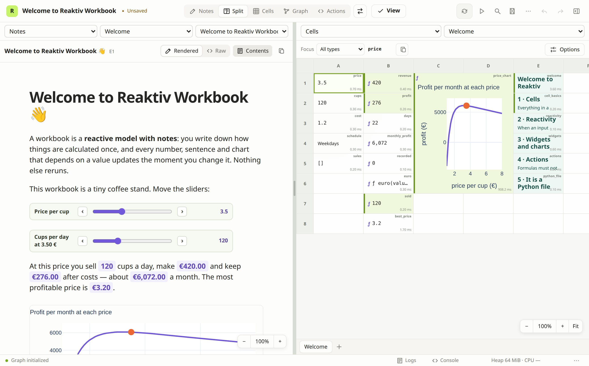

# Reaktiv Workbook

Reactive Python workbooks: spreadsheet cells, notes, plots, widgets and actions in one
plain Python file. Change an input and every cell, note and chart that depends on it
updates — and nothing else reruns.



- **Plain Python files.** A workbook is an ordinary `.workbook.py` file: readable in
  code review, diffable in Git, runnable with `python`, and typed for your IDE.
- **Notes and cells together.** Write documentation with live values, LaTeX, Mermaid
  diagrams and input widgets next to a spreadsheet-style grid and a dependency graph.
- **Real Python.** NumPy, pandas, Matplotlib, Plotly and anything installable; async
  resources, timers and explicit actions for work with side effects.
- **From the command line.** `reaktiv-workbook edit` opens the browser IDE on your
  machine; `run` serves the workbook as an interactive app.
- **Agents welcome.** `edit --mcp` lets coding agents read and edit the open workbook
  through MCP while you watch; the MCP server hands them its authoring guide. Agents
  that edit `.workbook.py` files directly can follow [Getting started](docs/GETTING-STARTED.md).

## Install

Reaktiv Workbook needs Python 3.12 or later.

```bash
pip install reaktiv-workbook plotly       # plotly draws the examples' charts
reaktiv-workbook new --from welcome        # a guided tour, copied to ./welcome.workbook.py
reaktiv-workbook new my-model.workbook.py  # a blank workbook of your own
```

or, without installing, with [uv](https://docs.astral.sh/uv/):

```bash
uvx reaktiv-workbook new --from welcome --sandbox
```

`new` creates the file and opens it in your browser; `--from` copies one of the bundled
examples, such as `welcome`, `budget` or `project-planner`. `edit` opens an existing
workbook, `run` shows it as an interactive app, and `check` evaluates it and reports cell
errors. Most examples use packages such as plotly or pandas, which a workbook declares
in its file. When some are missing, the command offers to run the workbook in a sandbox
with them (needs uv), or tells you what to install. `--sandbox` always uses one.

## A workbook

```python
from reaktiv import computed, field
from reaktiv_workbook import Workbook, Worksheet, cell, markdown, workbook_config, worksheet


class Sheet1Worksheet(Worksheet["BudgetWorkbook"]):
    income = cell("A1", field(3200), label="income")
    rent = cell("A2", field(1450), label="rent")

    @cell("B1", label="left")
    @computed
    def left(self):
        return self.income() - self.rent()

    @cell("C1", label="summary")
    @markdown
    def summary(self):
        return """# Budget

        After rent, **{{ self.left() }}** is left of **{{ self.income() }}**."""


@workbook_config({"formatVersion": 2, "name": "Budget"})
class BudgetWorkbook(Workbook):
    Sheet1 = worksheet(Sheet1Worksheet)
```

In the editor you change `rent` with a field or a widget; `left` and the note update.
In Python, `BudgetWorkbook().Sheet1.left()` returns `1750`. The editor writes this file
for you; you rarely edit it by hand. See [the workbook format](docs/WORKBOOK-FORMAT.md).

## Documentation

- [Getting started](docs/GETTING-STARTED.md): concepts, creating workbooks, best practices.
- [Feature guide](docs/FEATURES.md): notes, cells, graph, widgets, actions and the editor.
- [Command line](docs/STANDALONE-CLI.md) and [Python package](docs/PYTHON-PACKAGE.md).
- [All documentation](docs/README.md).

The same guide is an interactive workbook: `reaktiv-workbook edit examples/docs/guide.workbook.py`.

## Development

Development uses Python 3.12+, [uv](https://docs.astral.sh/uv/), Node.js 24 and npm.
Run commands from the repository root.

```bash
python3 scripts/bootstrap-python.py   # .venv with reaktiv from PyPI and the dev tools
npm ci
npm start                             # browser app on http://localhost:4200
uv run --no-sync reaktiv-workbook edit examples/welcome.workbook.py
```

Checks:

```bash
uv run --no-sync pytest tests/python -q
uv run --no-sync pyright
uv run --no-sync ruff check python tests scripts
npm test -- --watch=false
npm run build
npm run test:file-worker      # real Pyodide
npm run test:runtime-worker   # real Pyodide
```

Builds:

```bash
npm run build          # browser app: dist/reaktiv-workbook/browser/
npm run package:python # wheel and sdist with the browser IDE: release/python/
```

```text
frontend/   Angular application (src/) and browser assets and workers (public/)
python/     reaktiv_workbook: workbook engine, file format, CLI, HTTP runtime, MCP
examples/   Example workbooks, courses and the interactive user guide
scripts/    Asset syncing, builds, packaging and verification
tests/      Python tests and the workbook fixtures shared with the frontend tests
docs/       User guides and the architecture overview
```

[Architecture](docs/ARCHITECTURE.md) describes how the pieces fit together.
The reactive core is the separate [`reaktiv`](https://pypi.org/project/reaktiv/) package.

## License

[MIT](LICENSE)
