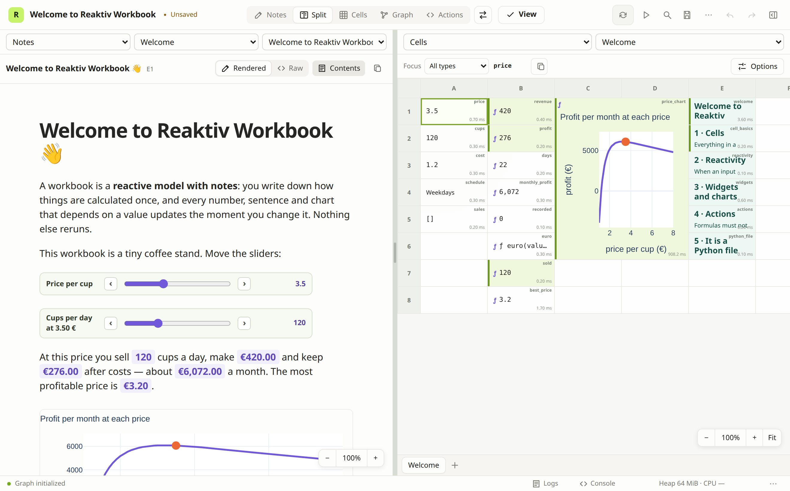

# Reaktiv Workbook

A reactive Python workbook with notes, spreadsheet cells, plots, widgets, and a browser IDE.
Workbooks are ordinary `.workbook.py` files (older `.sheet.py` files open too). Python 3.12 or newer is required.



```bash
pip install reaktiv-workbook plotly
reaktiv-workbook new --from welcome        # a guided tour of the ideas
reaktiv-workbook edit analysis.workbook.py
```

`new` creates a workbook (blank, or a copy of a bundled example with `--from`) and opens it.
`edit` opens an existing workbook, or creates a new one if the path does not exist.
No Node installation or separately started server is needed.

```bash
reaktiv-workbook new                          # create untitled.workbook.py and open it
reaktiv-workbook new --from welcome           # start from a bundled example (the guided tour)
reaktiv-workbook edit                         # open/create untitled.workbook.py
reaktiv-workbook edit analysis.workbook.py --port 8765
reaktiv-workbook run analysis.workbook.py        # interactive views, without authoring
reaktiv-workbook run analysis.workbook.py --headless
reaktiv-workbook check analysis.workbook.py
reaktiv-workbook evaluate analysis.workbook.py --cell total
reaktiv-workbook export analysis.workbook.py ./exports
```

The CLI owns the local server. Stop it with Ctrl+C. Closing the browser does not stop it.
Run mode accepts input/widget changes and exposed actions, but refuses authoring, console
code, and saving through the server. It is a local presentation mode, **not source-code
protection or a sandbox**; workbook definitions are sent to the browser.

Install workbook-specific packages into the same Python environment, for example:

```bash
pip install plotly pandas
```

Or let the CLI install the packages a workbook declares into an environment of its own
(requires [uv](https://docs.astral.sh/uv/)):

```bash
reaktiv-workbook edit analysis.workbook.py --sandbox
```

Without `--sandbox`, a workbook that declares packages missing here names them; in a
terminal with uv installed, the command offers to run it in a sandbox instead (Enter
accepts). The package itself installs no data libraries: numpy, pandas, plotly and the
like are declared by the workbooks that use them.

Coding agents can work on the open workbook through MCP:

```bash
reaktiv-workbook edit analysis.workbook.py --mcp
```

The server listens only on loopback, uses a per-session bearer token, and prints its
browser URL in the terminal. Open only workbooks you trust: workbook code runs as
ordinary Python, including enabled effects on startup. Requirements written in a
workbook are installed only with `--sandbox`.

`python analysis.workbook.py` continues to evaluate the workbook; it never launches the
server or IDE through its generated entry point. `reaktiv-workbook FILE --check` and the
other evaluator options work as well.

Built on [`reaktiv`](https://pypi.org/project/reaktiv/) (0.25 or later), the signal library.

This is an early release (0.1). Keep important workbooks under version control.
