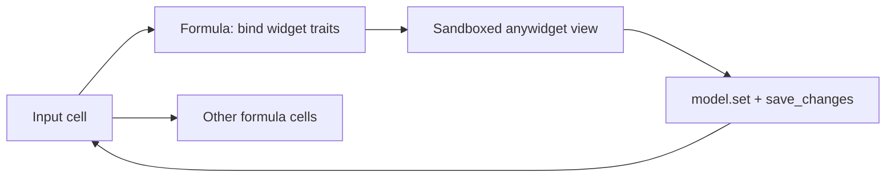

# Creating third-party widgets for Reaktiv Workbook

This guide is for library authors and coding agents building custom interactive
outputs. Use the existing **anywidget protocol**; there is no Reaktiv-specific
renderer registration or plugin manifest to implement. The widget can live in an
ordinary Python package, outside this repository.

For built-in input controls and changes to the app itself, see [WIDGETS.md](WIDGETS.md).
For workbook authoring, see [GETTING-STARTED.md](GETTING-STARTED.md).

## The contract

A formula cell returns an `anywidget.AnyWidget` instance. Its Python class declares
synchronized traits; its JavaScript ES module exports `render({model, el})`.
Reaktiv Workbook hosts the module in an isolated iframe, synchronizes the traits and
routes bound edits back to input cells.



The input owns application data. The widget presents that data and captures user
intent. Other cells read the input, never the widget's traits. Transient hover,
viewport and animation state may remain in the widget.

Widgets appear in rendered grid tiles and in Notes through a direct reference such
as `{{ counter }}` or `{{ Controls.counter }}`. A plain grid cell shows a summary;
the inspector also shows a lightweight summary. These are rich formula outputs,
not entries added to the built-in input-widget dropdown.

## A complete widget

The following module is the complete contents of an example package's
`third_party_widgets/__init__.py`. The package name is illustrative; choose your
own distribution and module names. Declare `anywidget` as a Python dependency.

```python
import anywidget
import traitlets


class Counter(anywidget.AnyWidget):
    value = traitlets.Int(0).tag(sync=True)

    _esm = """
    function render({ model, el }) {
      const button = document.createElement("button");
      button.type = "button";
      button.setAttribute("aria-label", "Increase count");

      const draw = () => {
        button.textContent = `Count: ${model.get("value")}`;
      };
      const increment = () => {
        model.set("value", model.get("value") + 1);
        model.save_changes();
      };

      button.addEventListener("click", increment);
      model.on("change:value", draw);
      el.append(button);
      draw();

      return () => {
        model.off("change:value", draw);
        button.removeEventListener("click", increment);
        button.remove();
      };
    }
    export default { render };
    """

    _css = """
    button {
      padding: 8px 12px;
      border: 1px solid currentColor;
      border-radius: 6px;
      color: inherit;
      background: transparent;
      font: inherit;
      cursor: pointer;
    }
    button:focus-visible { outline: 2px solid currentColor; outline-offset: 3px; }
    """
```

`model.set()` updates the local model. `model.save_changes()` sends pending changes
to the host. Listening for `change:value` makes the view respond to changes coming
from Python as well as its own interaction. Returning a cleanup function releases
resources when the view is disposed.

## Use it in a workbook

Install `anywidget` and your widget package in the selected Python kernel. For a
published package, add its distribution name to the workbook's Python packages
alongside `anywidget`. A local/remote kernel needs the package installed there;
a browser Python kernel needs a distribution compatible with Pyodide. A package
installed in the author's system Python is not automatically available to the app.

This complete workbook assumes `third_party_widgets` is already importable:

```python
from reaktiv import ReactiveModel, computed, field
from reaktiv_workbook import bind, cell, markdown, sheet
from third_party_widgets import Counter


@sheet({
    "name": "Third-party counter",
    "grid": {"columns": 6, "rows": 8},
    "environment": {"packages": ["anywidget"]},
})
class CounterWorkbook(ReactiveModel):
    count = cell("A1", field(0), label="count")

    @cell("B1", label="counter", view={"display": "rendered", "span": [2, 2]})
    @computed
    def counter(self):
        return bind(Counter(), value=self.count())

    @cell("D1", label="doubled")
    @computed
    def doubled(self):
        return self.count() * 2

    @cell("A4", label="controls")
    @markdown
    def controls(self):
        return """# Counter

{{ counter }}

Double the count: {{ doubled }}
"""
```

Start Python to interact. Clicking the widget updates `count`, which updates
`doubled` and every other dependent cell. Editing `count` through the normal input
editor updates the widget too.

In the formula editor, the equivalent source is:

```python
bind(Counter(), value=count)
```

The normal `self.count()` syntax in a `.workbook.py` method is translated by the
workbook compiler. A plain `ReactiveModel` run outside the workbook engine only
receives initial trait assignments from `bind`; it does not establish the app's
write-back behavior.

## Bindings and state ownership

- Each `bind` keyword is a synchronized trait on the widget. Its argument must be
  a direct input-cell reference, not a constant, computed value or expression.
  Linked inputs are supported too; widget edits create a manual override.
- Bindings write Python-literal values: finite numbers, strings, booleans, `None`,
  and lists/dictionaries of supported values. Arbitrary Python objects and binary
  buffers are not automatically writable through input bindings.
- For display-only derived data, pass a formula's value to the widget constructor
  as an ordinary trait value; do not bind it. Recreating the widget when that
  formula changes refreshes its data.
- Calculations in other cells read `count`, not `counter.value`. Reading another
  cell's widget traits raises `WidgetStateError`; the widget is a graph leaf.
- To change a bound value from a Python action, write the input cell. Assigning the
  widget trait itself does not update its bound input and can be replaced on the
  next evaluation.
- Treat unbound traits as runtime state. Do not depend on them for durable workbook
  data. Saved display snapshots do not replace input-cell persistence.
- A custom message is not an input binding. `model.send()` does not automatically
  update cells or participate in the input undo history.

Reaktiv Workbook owns binding resolution, input writes, undo/redo and workbook saving.
Do not reproduce that machinery inside a widget or call app internals.

## Module packaging, dependencies and isolation

Ship a self-contained ES module. You may author `_esm` inline as above, or use
anywidget's Python-side file support to load a packaged JavaScript asset. Include
that asset and any CSS in both the wheel and source distribution.

The host imports inline module text through a `blob:` URL. Consequently, an
unbundled relative JavaScript import does not resolve relative to your Python
package. Bundle dependencies into the shipped module, including JavaScript chart
libraries. Do not rely on remote JavaScript imports such as CDN/`esm.sh`; offline
and restricted networks block them.

The iframe has an opaque origin and `sandbox="allow-scripts"`. Work inside `el`;
do not access the parent document, the app's storage, or file pickers. Do not assume the frame can fetch arbitrary files or remote resources.
If the library needs file selection, keep the path in a workbook file/folder input
and perform I/O through Python cells or explicit actions.

`_repr_html_` is appropriate for static HTML. Reaktiv Workbook sanitizes that output
and removes executable JavaScript; it is not a substitute for an anywidget module.
Likewise, an unknown MIME type does not install a new frontend renderer.

### Integrating a chart library such as ECharts

Wrap the library in an anywidget rather than changing Reaktiv Workbook:

1. Expose a synchronized specification trait and, where needed, separate selection
   traits. Keep specifications serializable and bounded in size.
2. Bundle the chart library into the widget's ES module.
3. In `render`, create the chart under `el`, draw the current specification and
   subscribe to changes of the relevant traits.
4. Translate user selections into deliberate trait updates and `save_changes()`.
   Consumers bind those selection traits to input cells. Avoid echo loops when
   applying model changes to the chart.
5. Observe container resizing and resize the chart. Return cleanup that disconnects
   observers, removes listeners and disposes the library instance.

This is an integration recipe, not a built-in ECharts adapter or a new registration
API. The existing Matplotlib image and Plotly rendering paths remain unchanged.

## Lifecycle and performance

Python widget instances belong to their producing cell. Reevaluation creates a
replacement and closes earlier models. The host may keep a view alive and retarget
it to the replacement model, so do not assume one `render` call per Python object
or cache transport model IDs in application state.

The host supports `initialize` and `render` cleanup functions. Remove `model.on`
subscriptions with `model.off`, disconnect observers, clear timers, cancel
outstanding work and release chart/WebGL resources. Do not depend solely on a
Python `close` callback to clean up browser resources.

Give the content a real height; an absolutely positioned chart in a zero-height
container is invisible. The host observes content height and sizes the iframe.
Use responsive dimensions, support both light and dark themes, and use semantic
controls, accessible names and visible keyboard focus.

Send edits on meaningful changes. Throttle high-frequency pointer events and batch
related trait changes into one `save_changes()` call. A bound edit can reevaluate
other cells and replace the Python widget. Avoid sending large raw datasets when
a compact display specification or reduced data is sufficient. Rich outputs have
a 20 MiB limit; binary messages still consume transport and memory.

## Supported communication and limits

The host implements `model.get`, `set`, `on`, `off`, `save_changes`, `send`,
`msg:custom`, nested models through `widget_manager.get_model`, and
`experimental.invoke`. Binary values use the widget bridge and reach JavaScript as
`DataView` objects; they are separate from literal input bindings.

Python `on_msg` handlers receive custom messages; Python `widget.send()` messages
reach JavaScript's `msg:custom` listeners. Message callbacks passed to
`model.send(content, callbacks)` do not receive replies in this host. For
request/response behavior, use the supported command mechanism and test it against
Reaktiv Workbook. Prefer stable trait synchronization for ordinary value editing.

Stock ipywidgets controls are not rendered as standalone outputs: the host needs
an anywidget ES module. Their models may be used as nested models of an anywidget.
Interactive views need a running kernel for Python communication. Static exports
currently provide a widget placeholder rather than an interactive application.

## Validation checklist for authors and agents

Validate the package as an external consumer; importing private `reaktiv_workbook`
modules or modifying the app is not part of this extension contract.

- Install the built wheel in the actual kernel environment; verify packaged JS/CSS
  works without source-tree files or remote JavaScript imports.
- Return the widget instance from a formula, then show it in both Notes and a
  rendered cell tile. Merely constructing it in Python does not prove UI rendering.
- Test the bound input in both directions: widget edits update the input and its
  formulas; Python/input-editor changes reach the widget. Verify save/reopen and
  input undo/redo independently from transient widget state.
- Rerun the producing cell and restart the kernel. Check for duplicate listeners,
  timers, stale model IDs and resources left behind after the view is removed.
- Test disabled kernel interaction, errors, resizing, light/dark themes and keyboard
  use. Test Chromium, Firefox and Safari; their web engines differ.
- If browser Python is a supported target, test the actual package there rather
  than assuming CPython dependencies work under Pyodide.
- Validate a sample workbook with `reaktiv-workbook sample.workbook.py --check` when the
  CLI is installed. This checks Python execution; it does not prove JS rendering,
  package asset loading or interaction.

For source-level examples, see [anywidget-demo.workbook.py](../examples/features/anywidget-demo.workbook.py).
This guide describes the third-party integration surface.
