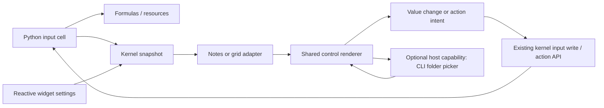

# Widgets: use and extend

A widget presents an input cell and sends user edits back to that cell. The input
owns the value; formulas, resources and plots read that input. The same input can
have controls in Notes, Cells and Graph. Start the Python kernel to interact with them.

In Graph, enable **Show outputs** to use input widgets and see plots, HTML and
anywidgets in graph cards. These use the same controls and rendering APIs as
worksheet tiles; third-party widgets need no graph-specific adapter. **Pin view**
keeps nodes and connections in place while inspecting cells; values and widgets
stay live. Unpin to follow current dependencies. Drag a card's lower-right handle
to enlarge a plot, including in a pinned view. Double-click the handle or press
Home while it is focused to reset; arrow keys adjust its size. Sizes last for the
open workbook session and do not modify cells or run Python.
Outputs default off to avoid mounting many charts unexpectedly. Focus/filter the
graph to limit the visible set, and use zoom, pan or Fit as needed.

## Choose a control

Select an input cell, choose its widget in the inspector, and switch its display to
Rendered. For larger controls, increase its tile span. In Notes, use **Insert
widget** and select that input, or write `[Input file](#sheet-input:source_file)`.
Notes inherit the input's configured widget type and resolved settings.

While editing a note, hover a direct input reference such as `{{ source_file }}`
to reveal **Show as widget**. Hover its widget to reveal **Show value** and switch
back. Keyboard focus also reveals the controls. The switches remain available
when an input has an error. These are saved note edits and support undo/redo; the input value
and its configured widget type stay unchanged. Computed cells and compound
expressions remain value references. Switch from reading to editing mode to use
these authoring controls.

| Type | Value written | Settings / behavior |
| --- | --- | --- |
| `number`, `range` | Number | `min`, `max`, `step` |
| `checkbox` | Boolean | On/off |
| `text`, `textarea` | String | `placeholder`; single/multiple lines |
| `date` | String | ISO date |
| `select`, `radio` | String | One of `options` |
| `list` | List of strings | Add/remove entries |
| `multiselect` | List of strings | Choose entries from `options` |
| `file`, `folder` | String | Type a path, or browse the CLI's machine |
| `button` | Number, boolean, or no value write | Count, toggle, or invoke an action |

### When an edit reaches the cell (`debounce`)

Sliders, text and number fields can update their input cell while they are being
edited. `debounce` is the wait in milliseconds after the last change; 0 applies every
change instantly. While a slider is dragged or a field keeps changing, the cell still
updates at least every 400 ms (or every `debounce` ms when that is longer). Committing
the edit (releasing the slider, Enter, leaving the field) always applies at once.

| Widget | Without `debounce` | With `debounce` |
| --- | --- | --- |
| `range` | 150 ms after the drag pauses | that wait (0: every step) |
| `text`, `number` | on Enter or leaving the field | while typing, after that wait |

Set it in the cell's widget settings (**Update delay (ms)**), in Python
(`view={"widget": {"type": "text", "debounce": 0}}`), or in a note's widget link
(`[Search: {{ query }}](#sheet-input:query?debounce=0)`). Whole milliseconds from 0 to
10000. Other widget types apply each change at once and ignore it. Instant updates
recalculate on every keystroke or slider step: keep it for cheap calculations.

### Files and folders

Choose **File path** or **Folder path**. In a workbook opened with
`reaktiv-workbook edit` or `run`, **Browse…** opens a picker that lists folders of
the machine running the CLI: open folders, filter, and
choose one existing file or folder. Only names are listed; file contents are never
read. The text field also accepts manually
entered paths, including paths that do not exist yet. Leaving the field applies
the edit. Canceling the picker preserves the value; failures appear beside the
control and can be retried.

The value is a path string, including spaces and Unicode. The widget does not read
or upload file contents, grant the Python kernel access, or automatically perform
I/O. Use a formula/resource or explicit action to read/write the selected path.
Paths save as quoted Python strings and use the normal input undo/redo flow.

| Host / kernel | Behavior |
| --- | --- |
| CLI session (`edit`, `run`) | Browse lists the folders of the machine running the CLI, starting next to the workbook; Python uses the chosen path. |
| Remote Python kernel | Browse is disabled; enter a path that exists on the server. |
| Browser Python (Pyodide) | Browse is disabled. Paths refer to its virtual filesystem. |

A picker finishing after the control is replaced or removed is ignored.
A control disables itself while its dialog is open. Kernel pause, widget disabled
or loading state, and hidden widgets block input writes through the shared adapter.

This is a complete minimal workbook; save it as `paths.workbook.py`:

```python
from reaktiv import ReactiveModel, field
from reaktiv_workbook import cell, markdown, sheet

@sheet({"name": "Paths", "grid": {"columns": 8, "rows": 8}})
class Paths(ReactiveModel):
    source_file = cell("A1", field(""), label="source_file", view={
        "display": "rendered", "span": [3, 3],
        "widget": {"type": "file", "label": "Input file"},
    })
    output_folder = cell("D1", field(""), label="output_folder", view={
        "display": "rendered", "span": [3, 3],
        "widget": {"type": "folder", "label": "Output folder"},
    })

    @cell("A5", label="controls")
    @markdown
    def controls(self):
        return """# Paths

[Input file](#sheet-input:source_file)

[Output folder](#sheet-input:output_folder)
"""
```

## State and data flow



Configuration is stored in `CellDefinition.view.widget`. The kernel resolves its
reactive settings and includes a `widget` object in the cell snapshot. Keep source
configuration separate from that resolved object: saving resolved settings would
replace expressions with their current values.

`label`, `placeholder`, `disabled`, `visible`, `loading` and `pressed` may be literals
or reactive settings. In Python files, use callbacks, for example
`"disabled": lambda self: self.busy()`. In the app's document model this is
`"disabled": {"expr": "busy"}`. Numeric bounds and option lists also accept
expressions. See [the authoring guide](GETTING-STARTED.md#reactive-widget-labels-and-state).

Settings are cached synchronous graph leaves. They can depend on inputs and
computed values; changing them does not reset the input. Configuration failures
are reported as widget errors separately from the input's value/error. Keep async
work in resources/actions, outside setting callbacks.

The renderer emits values through its `change` callback. Adapters convert these
using `widgetSource`, preserve input comments, and use the existing runtime update
path. That path owns persistence, linked-input overrides, undo/redo and evaluation.
A renderer must not mutate workbook documents, call signals, or invent another
store for the selected value. Temporary focus, draft text and pending dialog state
can live in the control. An action-mode button emits an action name rather than
writing a synthetic value. See [ACTIONS.md](ACTIONS.md).

## Built-in extension points

| Building block | Responsibility |
| --- | --- |
| `frontend/src/app/input-widgets.ts` | `WidgetType`, `WidgetValue`, inference, literal encoding, `RichWidgetModel`, shared rendering and builder registry |
| `frontend/src/app/widget-config.ts` | Source-setting helpers and shared interaction guards |
| `python/reaktiv_workbook/widget_config.py` | Supported types, configuration validation and reactive evaluation |
| `frontend/src/app/rich-widget.component.ts` | Angular grid adapter; emits values/actions and skips identical models |
| `frontend/src/app/note-nodes.ts` | Notes node views; reuse the shared renderer |
| `frontend/src/app/markdown-cell-editor.component.ts` | Resolves a note reference to the input's configuration/value |
| `frontend/src/app/widget-host.ts` | Optional platform capabilities; installs the CLI session's picker |
| `frontend/src/app/path-browser.ts` | Browse dialog over `/v1/files` for CLI sessions |
| `frontend/src/app/path-widget.ts` | File/folder DOM control and asynchronous dialog lifetime |
| `python/reaktiv_workbook/model.py` | The sole Python workbook writer and reader |

To add a compound built-in control:

1. Decide its input value type and interaction semantics. Reuse an existing type
   when only styling or settings differ. Extend `WidgetValue` and literal encoding
   only when the new value needs it.
2. Add the type to frontend `WIDGET_TYPES`, Python `WIDGET_TYPES`, and the inspector
   selector in `app.html`. Keep validation and saved-file round trips aligned.
3. Implement a builder with the `RichWidgetBuilder` contract:
   `(model, change, invokeAction) => HTMLElement`. Register it once in
   `RICH_WIDGET_BUILDERS`. Both Notes and grid recognize it through `isRichWidget`;
   they must not gain separate copies of its interaction logic.
4. Render only the resolved model. Use text/DOM APIs for labels and values. Honor
   disabled/loading state and send changes through the supplied callback. The
   common renderer handles visibility, loading guards, captions and action errors.
5. For expensive or platform-specific code, use a lazy module as the path widget
   does. Keep styles scoped to the control and stay within the initial bundle
   budget. Native single-element controls currently use adapter template branches;
   adding one there requires keeping both adapters consistent. Prefer the shared
   builder for a new compound control.
6. Add renderer/adapter tests, Python reactive-setting tests and a shared workbook
   case in `tests/fixtures/workbooks/cases.json`. Generate its Python snapshot via
   `sheet-file.workbooks.spec.ts`, then run the Python round-trip tests and CLI
   `--check`. Exercise a real `reaktiv-workbook edit` session when using a host capability.

The registry is typed and internal to the app. It is not a runtime plugin API.
Workbook authors can build custom controls with anywidget without patching it.

### Optional host capabilities

`WidgetHost` currently exposes:

```ts
interface WidgetHost {
  pickPath?: (request: {
    kind: 'file' | 'folder';
    current: string;
    label: string;
  }) => Promise<string | null>;
}
```

The renderer requests an operation; the host owns platform imports and dialogs.
An absent capability means unsupported; `null` means cancellation; rejection means
failure. Accept the host as an argument so control tests can exercise these cases
without opening system dialogs. In CLI sessions `RuntimeService` installs `pickPath`
(`browsePath` in `path-browser.ts`), which lists folders of the machine running Python
through the session's `/v1/files` route (names only, never contents) and returns a path,
not a copy. Browser Python has no picker: the field stays a manual path entry.

For any asynchronous capability, prevent duplicate operations and verify the
control is still mounted/current before applying a result. Ignore results after
rerender, removal, input replacement or a state change that disables interaction.
Do not add filesystem, kernel or persistence responsibilities to the host API merely
because a control needs a path.

## Custom controls with anywidget

Library authors and agents should start with [Creating third-party widgets](THIRD-PARTY-WIDGETS.md),
which includes a complete package module and workbook, packaging constraints and
a validation checklist.

For arbitrary HTML/JavaScript interactions, create an `anywidget.AnyWidget` in a
formula and use `bind(widget, value=input_cell)` to connect synchronized traits to
input cells. In a Python workbook method this is, for example,
`return bind(self.Counter()(), value=self.count())`; see the runnable
[anywidget demo](../examples/features/anywidget-demo.workbook.py).

The custom control runs in a sandboxed iframe. Its trait updates travel through
the widget bridge; bound traits write input cells through the shared runtime path.
Read the input from other formulas, rather than reading the widget's traits.
Transient animation and hover state may remain inside the custom control. Widget
instances belong to their producing cell and are released when it is reevaluated.

The built-in `WidgetHost` interface is internal to native app controls; it is not
exposed to sandboxed anywidget code. See [third-party widgets](THIRD-PARTY-WIDGETS.md) for
the anywidget protocol and lifecycle.
