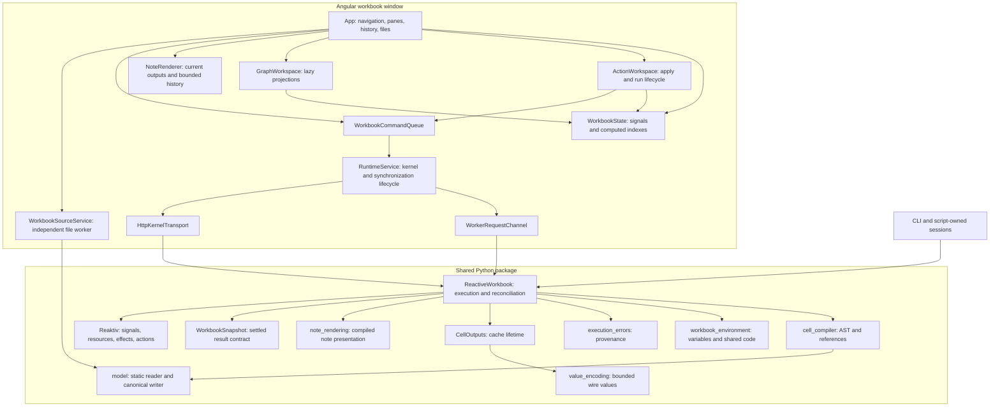

# Application architecture

The workbook is the product unit: an executable Python model, explanatory notes
and presentation. Angular edits and observes that model. Reaktiv owns execution.
Python owns the workbook file format. These boundaries apply to browser,
CLI and embedded use. The [user guide](index.md) describes what users see.

## Responsibility map



HTTP, browser and CLI adapters use the same engine. The static file worker neither
starts a kernel nor imports its runtime. CLI sessions supply host capabilities (folder
listings for path widgets, Git, the agent MCP bridge) through the same authenticated
session API.

## Angular ownership

Related code and tests belong in feature directories. Angular's
[style guide](https://angular.dev/style-guide) recommends organizing by feature
and keeping one concept per file. Generic `services/` or `utils/` folders would
hide the domain responsibilities here.

| Owner | Responsibility |
| --- | --- |
| `workbook/WorkbookState` | Cells, graph results, environment and actions; computed definitions, results, notes, timers, errors and dependency indexes |
| `actions/ActionWorkspace` | Apply/run status, confirmation, rollback, generation-checked live snapshot subscriptions and invocation feedback through typed ports |
| `graph/GraphWorkspace` | Visibility preferences, trace selection and lazy layouts |
| `notes/NoteRenderer` | Current Markdown renderings and bounded shared history for one window |
| `runtime/HttpKernelTransport` | JSON, captured credentials, performance timings and progress/log/live snapshot polling |
| `runtime/WorkerRequestChannel` | Worker lifetime, request correlation, pending promises and transport failure cleanup |
| `RuntimeService` | Kernel startup/restart, session revisions, stopped cells, usage and live-move synchronization |
| `agents/AgentActivity` | Window-local MCP request feedback, bounded activity entries, transient pulses and current-definition attribution; never workbook content or persisted history |
| `agents/agent-layout` | Passive on-demand DOM measurements and metadata-based grid sizing/readability suggestions; never navigation, graph layout construction, kernel execution or automatic resizing |
| `App` | Navigation, editors, history, open/save/recovery workflows and host interactions |
| `edit --mcp` (`standalone.start_agent_bridge`) | MCP HTTP service started with the CLI editor; its address and token reach the editor in the link |
| `agents/AgentConnection` | Explicit per-window sharing, authenticated loopback polling, request correlation and revocation |
| `agents/LiveAgentWorkbook` | Source/result revision checkpoints and validation through narrow ports; commits run in the existing workbook command queue |

The state and workspaces are ordinary typed classes constructed once per window.
Live MCP joins these owners instead of creating a second workbook/kernel. Presentation context is sampled from navigation signals without reading graph layouts or evaluating cells.
The Python bridge holds leases and pending requests only. Passive introspection and interrupts bypass the apply queue; cell edits/read/save and presentation writes remain ordered. Action edits use ActionWorkspace's guarded queue; invocation startup is ordered while async lifetimes may overlap; they are not wrapped in an outer queue wait. MCP guide resources are bundled static Markdown, not window or runtime state. Kernel lifecycle controls use existing app actions with a queue barrier, avoiding nested queue waits.
The command coordinator writes their signals; views consume values and emit intent.
Aliases in `App` refer to the same signals, rather than copying their values.

Use `computed` for derived state; keep `effect` for imperative integrations such as
storage, clocks and external rendering. This follows Angular's guidance on
[effects](https://angular.dev/guide/signals/effect) and
[signals](https://angular.dev/guide/signals). An effect must not synchronize two
writable copies of the same fact.

Action Apply and run remain different commands. Apply sends one definition and
the expected revision through the shared queue. Python compiles before installation
and returns a canonical acknowledgement; no placeholder workbook is generated or
inspected. Apply never invokes the action. Feature ports expose only the operations needed by that
workflow; they do not receive `App` or manipulate DOM.

Graph layouts are signals consumed inside the graph template. Creating a notes or
cells pane does no layout work. Two visible global graphs share one layout;
sheet-filtered panes have their own derivation. This presentation laziness does
not change Python evaluation semantics.

Graph outputs are opt-in and reuse the worksheet output template. Result metadata
determines variable card dimensions without decoding payloads. `GraphWorkspace`
owns per-pane visual pins: layout/connections freeze while values and inspection
remain live. Pins contain no output payloads, follow pane swaps, prune deletions,
and clear on document replacement and coordinate-changing edits.
Optional scrollable levels (**Graph → Scrollable levels**) reuse those cards and
connections; `GraphWorkspace` owns the preference and per-pane `GraphLevelScrollState`
(offsets and selection intent only) and `GraphLevelsComponent` projects clipped
connectors from native scrolling without changing the captured layout. `graphLevels`
groups existing layout geometry; `projectGraphLevels` computes visible endpoints and
indicators from scroll offsets and the measured viewport, once per animation frame.
Pins keep their captured nodes, connections and direction; scrolling never reads cell
signals, evaluates cells, or changes source, dirty state or undo history.

`workbook/dependency-index.ts` indexes producers to consumers. Direct-dependent
navigation avoids rescanning every edge; affected-cell traversal visits each
reachable edge once. This metadata controls UI feedback, never execution order.

## Python ownership and types

`ReactiveWorkbook` retains stable slots, reconciliation, transactions, resources,
clocks and widget lifetimes. Those operations share execution invariants; do not
replace them with a second scheduler during structural changes.

| Module | Boundary |
| --- | --- |
| `cell_compiler.py` | Source and `ReferenceScope` → `CodeType` and static references; no evaluation |
| `execution_errors.py` | Failure types, bounded tracebacks, cell filenames and provenance |
| `workbook_environment.py` | Tracked variables and shared-code namespace initialization |
| `cell_outputs.py` | Identity-based figure/table caches, bindings and preparation timing |
| `value_encoding.py` | Equality, display and bounded JSON-compatible cell values |
| `note_rendering.py` | Compiled note evaluation and output resolution through callbacks |
| `workbook_snapshot.py` | Settled result fields and the existing wire representation |
| `model.py` | Static parsing, reference rewriting and the sole workbook writer |

Output preparation receives an already evaluated value and never reads a signal.
Caches hold the current value only. Changed/failed cells discard their entries;
closing clears the output cache. Mutable widget state bypasses figure cache reuse.
Trace metadata still distinguishes preparation from reuse in the same update.

Use Python 3.12 annotations, collection interfaces and concrete types such as
`CodeType` where the representation is known. Arbitrary author values legitimately
use `Any`: a JSON-only type would prohibit arrays, functions, plots and user objects.
Validate external data at its boundary and keep strict Pyright enabled. The official
[typing guidance](https://typing.python.org/en/latest/reference/protocols.html)
describes structural protocols when a boundary needs them; interfaces should
describe actual collaborators rather than mirror all fields of the engine.

## Lifetimes and performance constraints

* One signal state and one set of feature workspaces per window.
* Structural commands share one queue; accept results before the next structural mutation starts. Async action lifetimes and literal input writes use the session owner's event loop.
* Worker termination rejects pending work. Unsendable messages remove their
  pending entry; messages and errors from retired workers are ignored.
* HTTP operations capture endpoint/token once. Kernel changes invalidate progress
  polling and prevent an obsolete pending mutation from dispatching. Late results
  cannot replace the new kernel's status. Action results are checked against their
  workbook generation before publication or activity cleanup. Mutations are not
  automatically retried.
* Action display snapshots are throttled on the execution owner and transported
  beside the pending request. They preserve source changes, drafts, undo and final
  tracing; the final response alone commits edits. HTTP retains only the latest
  frame and never reads the graph from the activity-poll thread.
* Markdown retains one latest rendering per current renderable cell, independently
  of the shared cache. Unchanged outputs must not be reparsed when a workbook is
  larger than the shared cache budget. Removed cells and disabled string rendering
  release their current records when the projection refreshes. Formatting revisions
  invalidate both layers; asset URL changes update the cell's rendered source.
* Shared Markdown history retains at most 256 entries and 4 Mi characters across
  source and HTML. This bounds historical/transient reuse, not the current workbook's
  outputs. Active and shared entries can reference the same strings: diagnostics
  report them separately, and their logical lengths are not additive heap bytes.
  Both layers clear on document replacement and window destruction.
* Existing raw-value, plot, diagnostic-history and file-worker limits remain.
  Workbook-owned source-only saves still skip snapshot generation and encoding.
* `DocumentChanges` compares immutable source checkpoints exactly, skipping unchanged
  subtrees. Dirty checks never serialize the document. Recovery source writes
  debounce at 450 ms; optional, revision-checked output sidecars are throttled to
  10 seconds and honor the workbook's output-save policy.
* Update tracing is experimental and defaults off, including Python collection.
  `experimentalUpdateTracing=1` in the window URL exposes it and enables collection
  on apply. Error diagnostics independent of update traces remain active.

Measure with **Settings → App → Record performance**. A faster
frontend projection does not establish a speedup in Python calculations.

## Reproducible development

From the repository root:

```bash
uv sync --locked
uv run --locked pyright
MPLBACKEND=Agg uv run --locked pytest tests/python -q
MPLBACKEND=Agg uv run --locked reaktiv-workbook examples/personal-life-dashboard.workbook.py --check
npm ci
npm test -- --watch=false
npm run test:file-worker
npm run test:runtime-worker
npm run build
```

The app lockfile includes test/type-check dependency groups. `tool.uv.sources`
selects the checked-out Reaktiv core in editable mode. The app requires Python
3.12; the standalone core retains its supported Python versions, with a separate
development environment. uv documents
[path sources and dependency groups](https://docs.astral.sh/uv/concepts/dependencies/)
and the Python-version constraint shared by
[workspaces](https://docs.astral.sh/uv/concepts/projects/workspaces/).

Development groups do not become published runtime requirements or mandatory
plotting dependencies for end users. Existing `.[dev]` installation remains
supported. CI checks the app independently of the core compatibility matrix.
Angular tests run isolated with test code splitting disabled: shared ESM chunks
caused native API spies to affect a different module instance depending on test
order. These options are documented in the
[Angular test CLI](https://angular.dev/cli/test); they change test builds only.
The execution-worker check runs actual Pyodide, loading NumPy from the pinned
runtime's official CDN on its first run and caching packages in the temporary
directory. It covers module loading, async resources, linked values, notes,
actions, streaming output and update traces. The static file-worker check stays
independent of execution and user packages.

## Refactoring discipline

Move a responsibility with its tests and actual state ownership. Do not introduce
mixins that merely distribute root methods, pass `App` into features, or maintain
a second workbook store. `App` still contains substantial pane, history and file
orchestration; changes in those areas should extract coherent workflows through
narrow ports, as actions now do, rather than expanding the shell.

Public workbook imports, Python source files, snapshot JSON, action semantics and
native capabilities remain compatible. Demand-based Python execution or a new
transport/file protocol needs a separate design decision.

## Structured Python source

`workbook_format.py` owns format-2 worksheet boundaries and scoped reference
translation; it reuses the legacy cell codec in `model.py` to preserve every cell
kind. `composition.py` provides typed native `Workbook`, `Worksheet` and
`worksheet()` descriptors, initializing all worksheet namespaces before starting
eager resources/effects. Python remains the sole source writer. See
[file format](file-format.md).

Legacy opening provenance comes from the static `file_api.inspect_document`
boundary (and `sourceFormatVersion` in CLI session state). `WorkbookState.migration`
owns per-window save protection and recovery metadata;
`WorkbookMigrationNoticeComponent` renders it in the notices row. CLI sessions upgrade
the file in place on save (`/v1/session-save`); the browser downloads it under a new name.

## Agent visual inspection

LiveAgentWorkbook exposes narrow worksheet/environment/asset/capture ports into the
window owners. Shared code/packages join the existing undo snapshot; package
activation remains an explicit kernel operation. `agents/agent-visual.ts` lazily
loads DOM capture for one requested cell/note, never app chrome. It returns bounded
PNG data only on explicit MCP inspection. Layout fit stays passive and independent
of captures.


MCP pixel sizing validates pure track patches in `agents/agent-track-layout.ts`;
the window owns the layout signals and layout-only history. It bypasses Python
calculation. Atomic MCP moves reuse the existing live runtime move command;
label changes use the same `refactorCellLabel` plan as inspector Apply. Both
protect drafts and revisions.


Native `BoundAction` owns per-method function-call state and duplicate guards; the workbook
owns individual invocation receipts. `execution_gate.ExecutionGate` coordinates
structural mutations with active tasks on the persistent HTTP owner loop (or the
existing session loop). The worker and frontend command queue use the same
startup/lifetime distinction. `set-inputs` changes literal values on the owner
without recompilation; `action_inputs.ActionInputs` remains a legacy admission
adapter.

## Standalone Python distribution

`commands.py` owns console subcommands; generated workbook entry points retain
the evaluator in `cli.py`. `standalone.py` owns CLI startup/wait/shutdown and
frontend discovery, while `WorkbookSession` owns the workbook execution loop and
its HTTP server. `session_assets.py` transfers bounded content-addressed images.
The server supplies the frontend session mode; `run` rejects authoring independently
of the UI. `scripts/build-python-package.mjs` prepares production web package data
and builds the Sheet and companion core release candidates. See
[Development](development.md#build-and-release-the-python-package) for the public package dependency boundary.

The workbook keeps the action lifecycle; the separate `reaktiv` package provides the
signals and passive graph metadata through its public APIs.
