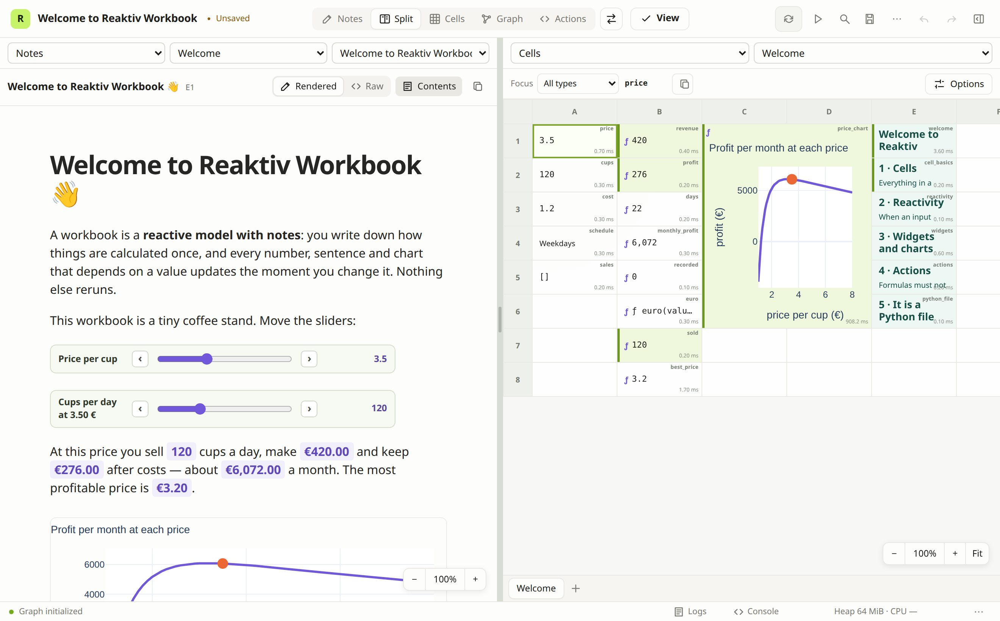

# Reaktiv Workbook

A spreadsheet where every cell is Python. Change an input and every value, chart and
paragraph that depends on it updates; nothing else reruns.



A workbook is one plain Python file, `name.workbook.py`. You see it three ways:

- **Notes**: documents with live values, sliders and charts.
- **Cells**: a grid of inputs, formulas and plots.
- **Graph**: what depends on what, drawn from your code.

## Install

Try it without installing, with [uv](https://docs.astral.sh/uv/):

```bash
uvx reaktiv-workbook new --from welcome     # a guided tour
```

Or install the `reaktiv-workbook` command:

```bash
uv tool install reaktiv-workbook            # or: pip install reaktiv-workbook
reaktiv-workbook new --from welcome
```

Python 3.12 or newer. The editor opens in your browser; nothing else to install.

## Three ideas

1. **A cell is a value with a name.** `deposit`, `rate`, `balance`.
2. **Mentioning a cell depends on it.** `deposit * 12` reruns when `deposit` changes.
   There is no "run all" and no execution order to manage.
3. **Notes are cells too.** `Your balance is {{ balance }}` stays true.

## Where next

- [Getting started](getting-started.md): build your first workbook in ten minutes.
- [Cells](cells.md): the kinds of cells and how they reference each other.
- [Command line](cli.md): open, check and run workbooks.
- [Agents](agents.md): let Claude Code or another MCP client work in your workbook.
